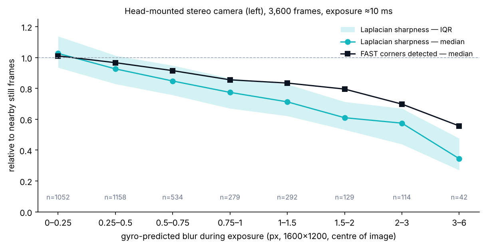
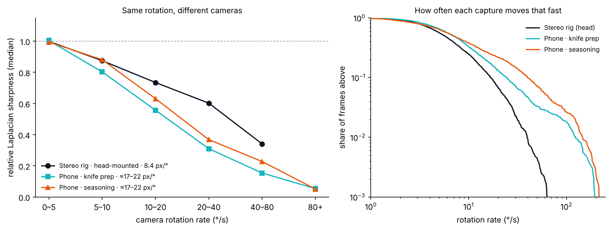
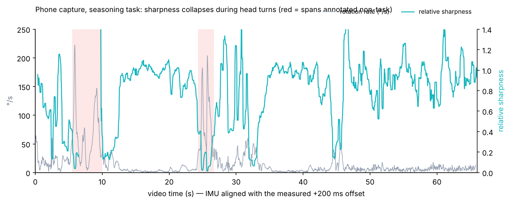
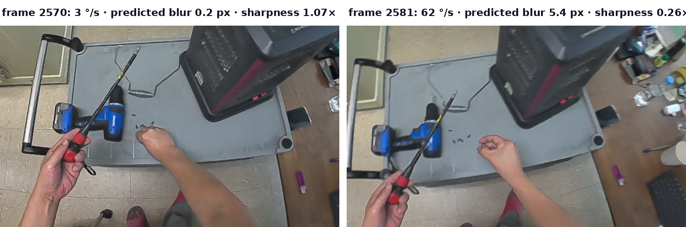

# Motion Blur in Egocentric Video — Gyro-Predicted Blur vs Measured Sharpness

Analysis code and per-frame results for **Origin Data Lab Technical Field Note #06** — *How Head Rotation Blurs Egocentric Video*.

All values were re-derived from the source recordings for this release (end-to-end re-run) and match the 120 values published in the first version of Field Note #06.

## Contents
| Path | Description |
|---|---|
| `analysis/reproduce_fn06.py` | Full pipeline from source recordings (video, frame timestamps, IMU) → per-frame table and all aggregates |
| `analysis/summarize_from_csv.py` | Recomputes every aggregate from the public CSV files and compares with a reference |
| `analysis/config.example.json` | Input-path template for the full pipeline |
| `data/stereo_rig_frames.csv` | 3,600 rows — head-mounted stereo rig, left camera |
| `data/phone_frames.csv` | 3,957 rows — two body-worn phone recordings |
| `results/results_fn06.json` | Aggregates produced by the full pipeline |
| `methodology.md` | Definitions, method, parameters, limitations |

## Visual results

### Predicted motion blur vs relative sharpness



### Camera rotation rate vs relative sharpness



### Phone recording: motion and sharpness timeline



### Example: sharper and motion-blurred frames



## Key results
* Gyro → image map fit: R² = 0.974
* Spearman ρ (predicted blur vs relative sharpness): -0.62
* Gyro-only flag for frames that lost >40% sharpness: AUC 0.92 (rig), 0.88 / 0.93 (phones)
* Frames above 20 °/s: 6.8% (rig), 13.2% / 21.6% (phones)

| Predicted blur | Frames | Median rotation | Relative sharpness | Relative FAST corners |
|---|---:|---:|---:|---:|
| 0–0.25 px | 1,052 | 3 °/s | 1.03 | 1.01 |
| 0.25–0.5 px | 1,158 | 5 °/s | 0.93 | 0.97 |
| 0.5–0.75 px | 534 | 8 °/s | 0.85 | 0.92 |
| 0.75–1 px | 279 | 11 °/s | 0.77 | 0.86 |
| 1–1.5 px | 292 | 15 °/s | 0.71 | 0.83 |
| 1.5–2 px | 129 | 21 °/s | 0.61 | 0.80 |
| 2–3 px | 114 | 29 °/s | 0.57 | 0.70 |
| 3–6 px | 42 | 45 °/s | 0.34 | 0.56 |

## Reproduce
```bash
pip install numpy pandas scipy scikit-learn opencv-python-headless
python analysis/summarize_from_csv.py data/stereo_rig_frames.csv data/phone_frames.csv results/results_fn06.json
# expected: "compared 273 values with reference, mismatches: 0"
```
The full pipeline (`reproduce_fn06.py`) needs the source recordings, which are not distributed. Environment used: Python 3.13, OpenCV 5.0.0, NumPy 2.5.3, pandas 3.0.5, SciPy 1.18.1, scikit-learn 1.9.1, FFmpeg 6.1.1; 2-core CPU; about 100 s wall clock.

## Not included
Source videos, raw IMU and timestamp files, camera calibration files (manufacturer-supplied), and any customer material. The CSV files contain no images, audio or personal identifiers.

## License
**Code:** MIT License (`LICENSE`), Origin Data Lab’s own analysis code.

**Data (per-frame statistics CSV) and documentation:** CC BY 4.0 is prepared (`LICENSE-DATA-CC-BY-4.0.md`) but **not yet in force** — it applies only after Origin Data Lab confirms operator consent, contractual terms of the phone recordings and publication of device exposure-time data. Until then the data files must not be published. CC BY 4.0 permits commercial reuse.

## Citation
Origin Data Lab (2026). How Head Rotation Blurs Egocentric Video. Technical Field Note #06. https://origindatalab.io/technical-field-notes/motion-blur-egocentric-video.html
